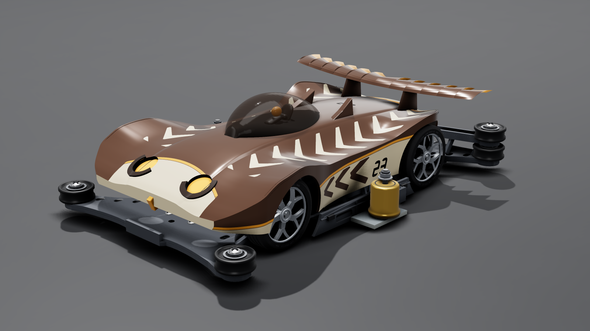
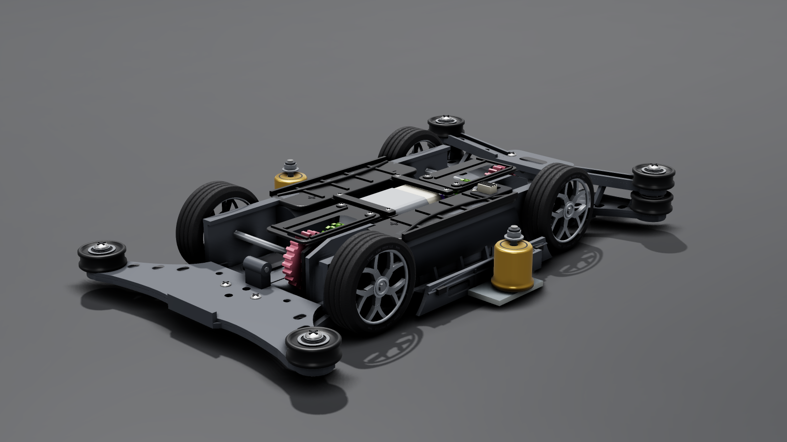

# mini4wd：迷你四驅車物理模擬與換件車庫

在瀏覽器裡組裝迷你四驅車、換零件、上賽道跑三圈。每個零件都用真實尺寸、質量與物理參數建模，組裝結果會依官方比賽規則檢查是否合法。

使用 Three.js 繪圖、Rapier 物理引擎，測試用 vitest 與 Playwright。

<p align="center">
  
  
</p>

## 特色

- **零件只透過物理量影響結果**：質量、慣性、幾何、接觸位置與法向、摩擦、恢復係數、彈簧與阻尼、電路電阻、馬達特性曲線、齒輪比、傳動效率。沒有「速度 × 1.1」之類的倍率捷徑，也沒有針對特定零件的特例分支。
- **約 100 款零件、20 多個類別**：馬達、齒輪、輪胎、導輪、導輪架、制振器、煞車、配重、穩定頭、電池、開關等。每款都附規格來源，查不到實測的數值標「推估」並寫出依據。
- **2 款底盤**：中置雙軸馬達底盤，以及後置單軸馬達加傳動軸的底盤。兩款底盤各有自己的零件相容表。
- **19 款原創車殼**：包含比賽常見的車殼型態，以及 90 年代賽車卡通風格的致敬款。可選擇「切輪拱」以裝上大徑輪。
- **規則檢查**：`validateAssembly()` 依官方規則檢查尺寸、重量、離地高度、齒輪比、馬達類別、安裝位置與底盤相容性，違規時回傳違規代碼與中文說明。本專案自訂、官方條文沒寫的檢查一律標「推估規則」。
- **物理機制**：
  - 線性 DC 馬達與電池內阻、傳動系等效轉動慣量
  - 輪胎摩擦與滾動阻力、導輪與牆的接觸（含錐形與傾斜導輪）
  - 制振器滑動或擺動的自由度、滑動保桿（彈簧、阻尼、止擋）
  - 單向輪（單向離合）、煞車海綿的接觸
- **能量守恆有測試把關**：斷電後的總機械能只會減少。內部零件的作用力與反作用力大小相等、方向相反；接觸類零件只在實際接觸時受力。

## 快速開始

需要 Node.js 22.12 以上（vitest 的要求）。跑測試還需要 Python 3。

```bash
npm install
npm run dev
```

瀏覽器會自動開啟 `http://localhost:47321/web/index.html`。這個 port 是固定的，被占用時會直接報錯，不會改用其他 port。

## 頁面

| 頁面 | 網址 | 用途 |
| --- | --- | --- |
| 主畫面 | `/web/index.html` | 3D 檢視整車與賽道 |
| 換件車庫 | `/web/garage.html` | 逐一挑選零件、即時檢查合法性、跑三圈計時、比較不同組裝 |
| GLB 匯出 | `/web/export.html` | 給 `node scripts/export-glb.mjs` 用的頁面，把整車或底盤匯出成 GLB（輸出到 `exports/`） |

網址參數可以直接指定組裝內容，方便分享或重現：

- `?config=<名稱>`：載入 `configs/<名稱>.json` 的組裝設定，例如 `default`、`speed`、`technical`、`p7-demo`、`vz-tuned`。
- `?body=<車殼 id>`：換車殼。
- `?<slot>=<零件 id>`：換單一零件，例如 `?motor=motor-torque&gear=gear-3.5`。
- `?archCut=1`：切輪拱。
- `?view=front34`：視角（主畫面）。

## 指令

| 指令 | 說明 |
| --- | --- |
| `npm run dev` | 啟動開發伺服器 |
| `npm test` | 跑全部 vitest 測試（`tests/`），包含物理、規則與瀏覽器測試 |
| `npm run score` | 跑 P01–P20 共 20 項驗證並計分 |
| `npm run render` | 用無頭 Chromium 為每款車殼截圖，輸出到 `renders/` |
| `node scripts/export-glb.mjs [<車殼 id>] [--config <名稱>]` | 匯出 GLB 到 `exports/`，給 Blender 展示圖使用（車殼 id 用 `none` 只匯出底盤與零件） |

`npm test` 和 `npm run score` 很吃 CPU，會透過 `scripts/heavy.py` 取得檔案鎖，同一時間只跑一個。

## 專案結構

```
src/
  assembly.js       整車組裝：由組裝設定解析零件，推導質量、重心、慣性、外框
  regulation.js     規則檢查（違規代碼與說明）
  sim.js            物理模擬（Rapier）
  contactSolver.js  導輪／牆接觸求解
  powertrain.js     馬達、電池、傳動系
  track.js          賽道幾何
  model.js          3D 模型
  parts/            各類零件資料與相容表
  bodies/           車殼外形
configs/            組裝設定（JSON）
web/                網頁（主畫面、換件車庫、GLB 匯出）
tests/              物理與規則驗證測試
scripts/            計分、截圖、匯出、診斷工具
renders/            截圖（不納入版控，只有本 README 用的 2 張例外）
```

## 新增零件或車殼

座標系、必填欄位、相容性宣告與規則檢查的寫法，請見 [`EXTENDING.md`](EXTENDING.md)。

## 已知限制

- 部分數值查不到實測資料，例如多數彈簧常數、空氣阻力係數 C_d、部分馬達參數。這些數值都標「推估」並寫出依據；已改用實測值的是輪胎摩擦與導輪滾動阻力。
- 模擬沒有考慮零件彎曲、溫度與磨耗。
- 目前沒有正式的靜態網站打包設定（`vite build`）。
